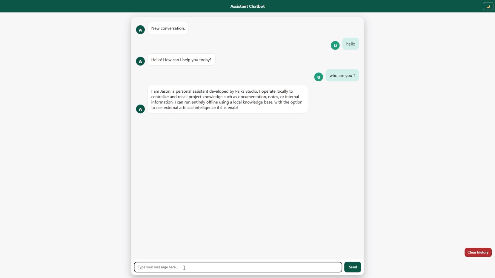

<p align="center">
  
</p>

> 🇬🇧 English | [🇫🇷 Français](./README_FR.md)


[](https://www.youtube.com/@Palks_Studio)
[](https://www.linkedin.com/in/palks-studio/)
[](https://dev.to/palks_studio/building-a-local-personal-assistant-instead-of-using-saas-tools-3fpn)
[](https://palks-studio.com/en/flask-chatbot)

<p align="center">
  <a href="https://palks-studio.com">
    
  </a>
</p>

# Advanced Flask Chatbot — Version 2.0

> This repository is a technical presentation and documentation repository.  
> It does not contain downloadable source code or production files.

A complete project to build your own **Flask-based conversational assistant**, ready to run:  

- **locally (localhost)**  
- **on shared hosting such as o2switch (Passenger / cPanel)**

No external database, no hidden dependencies. You can use it as-is, modify it, or integrate it into another website or API.

[View the Resource](https://palks-studio.com/en/flask-chatbot)

---

## Overview

This project provides a self-hosted conversational assistant built with Flask,  
designed for developers and teams who want full control over their chatbot’s behavior and deployment.

The architecture prioritizes:  

- a local knowledge base (JSON) as the primary source  
- predictable behavior in professional environments  
- optional AI integration (OpenAI)  
- simple deployment without dependency on external SaaS platforms

---

## Project Structure

```
flask_chatbot_advanced_2.0/
│
├── core/                     → Chatbot logic and processing
├── interface/                → Frontend (chat UI and widget)
├── storage/                  → Optional persistence layer
├── config/                   → Environment and dependencies
├── deployment/               → Hosting and container setup
├── data/                     → Example knowledge base
├── logs/                     → Error tracking system
│
└── docs/
    ├── README_TECHNIQUE.md   → Technical documentation and internal architecture
    ├── README.md             → Main project documentation and guides
    ├── CUSTOMISATION.md      → Bot customization (design, responses, OpenAI…)
    └── INSTALL.md            → Complete user guide
```

Curious to see the full application? The complete demo playlist is available here: [Watch the Complete Demo Playlist](https://www.youtube.com/watch?v=EqudjEgRfNY&list=PLUF3rX2oTtqs)

For a closer look at the technical architecture, this article explores the design of this local conversational assistant, the engineering choices behind it, and the benefits of building your own assistant instead of relying on SaaS tools.

👉 [Building a Local Personal Assistant Instead of Using SaaS Tools](https://dev.to/palks_studio/building-a-local-personal-assistant-instead-of-using-saas-tools-3fpn) (DEV.to)

---

## Key Features

- **Compatible with o2switch / Passenger (shared hosting)**  
- **No database required** (JSON-based operation)  
- **Readable, well-commented and easily customizable code**  
- **CORS enabled:** usable with websites or frontend interfaces  
- **Integrated logging system:** errors automatically recorded in `/logs/`

---

## Typical Use Cases

This chatbot is designed for:  

- internal knowledge assistants  
- support or documentation automation  
- self-hosted AI assistants  
- internal tools requiring controlled responses  
- websites embedding a chatbot widget

The system can operate fully offline using a local knowledge base,  
or optionally use OpenAI when extended responses are required.

---

## Configuration and Automatically Generated Files

Some files are generated automatically when using the chatbot, while others must be configured depending on the desired features.

| File                    | Purpose                                                                |
|-------------------------|------------------------------------------------------------------------|
| Persistence file        | May be generated to store conversations if persistence is enabled      |
| `logs/errors.log`       | Created only when a server error occurs                                |
| Environment file        | Must be created from the provided template to enable optional features |

---

## Operating Modes

| Mode                      | Description                                       | Requires OpenAI Key |
|---------------------------|---------------------------------------------------|---------------------|
| **Local JSON** (default)  | Responses generated from the local knowledge base | No                  |
| **OpenAI GPT (optional)** | Uses OpenAI API when a key is provided            | Yes                 |

The local knowledge base remains the primary source. When an OpenAI API key is configured, the chatbot can also use OpenAI to provide extended responses.

No calls to the OpenAI API are made when no API key is configured.

---

## Error Logs

The `logs/` directory automatically records Flask server errors:  

- automatic creation of log files when an error occurs  
- automatic creation of the `logs/` directory if missing  
- recording of date, error message and full traceback

This system works:  

- in local mode  
- with or without OpenAI  
- in production (Passenger / shared hosting)

---

**Palks Studio — Version 2.0 (Advanced Edition)**  
Compatible with Python 3.12+ and Flask 3.0+

© Palks Studio — see LICENSE.md  
- https://palks-studio.com
